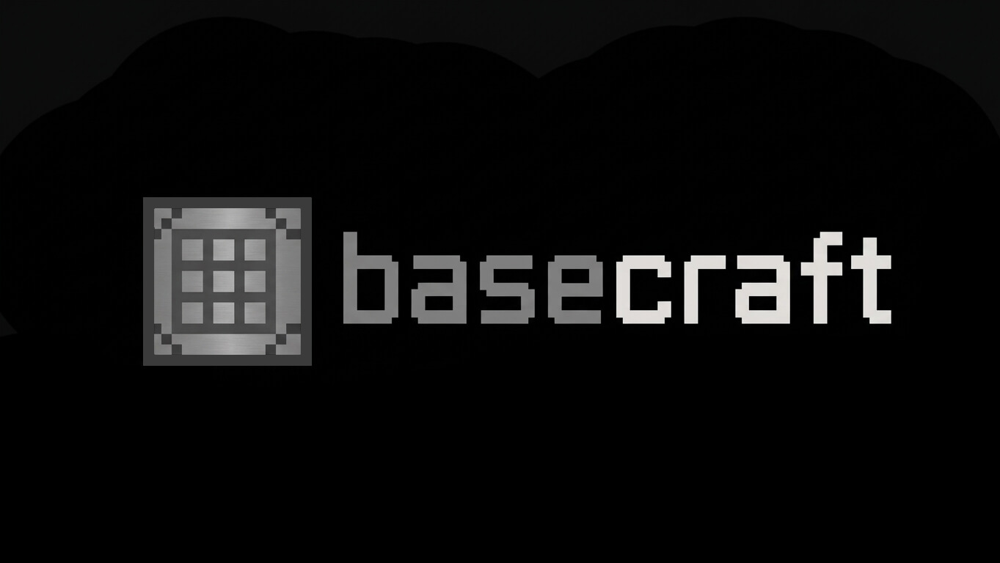

<p align="center">
  
</p>

<h1 align="center">Basecraft</h1>

<p align="center">
  Piezas chicas en TypeScript para armar casos de uso con validación y errores de dominio tipados.
</p>

---

Basecraft es un monorepo con las bases que uso para estructurar la lógica de negocio de una app: esquemas para validar datos, casos de uso que reciben dependencias y usuario, y un `Result` para no andar tirando excepciones por todos lados.

Todavía está en desarrollo, así que la API puede cambiar.

## Paquetes

| Paquete | Qué hace |
| --- | --- |
| `basecraft-core` | Esquemas (`string`, `number`, `boolean`, `array`, `object`), `createUseCase`, `createValidator` y `createResult` |
| `basecraft-types` | Los tipos compartidos entre los demás paquetes |
| `basecraft-errors` | Errores base, como `DomainError` |

## Ejemplo rápido

```ts
import { createUseCase, createResult, string } from "basecraft-core";

const createPost = createUseCase({
  authenticationRequired: true,
  allowedRoles: ["admin", "editor"],
  requestShape: {
    title: string().contains("ist"),
  },
  handler: async (dependencies, request) => {
    dependencies.logger.log(`Procesando post: ${request.title}`);
    return createResult.success({ id: "post_123" });
  },
});
```

## Cómo empezar

```bash
npm install
npm run build
npm test
```

Otros scripts útiles: `npm run check:types` y `npm run check:code`.
