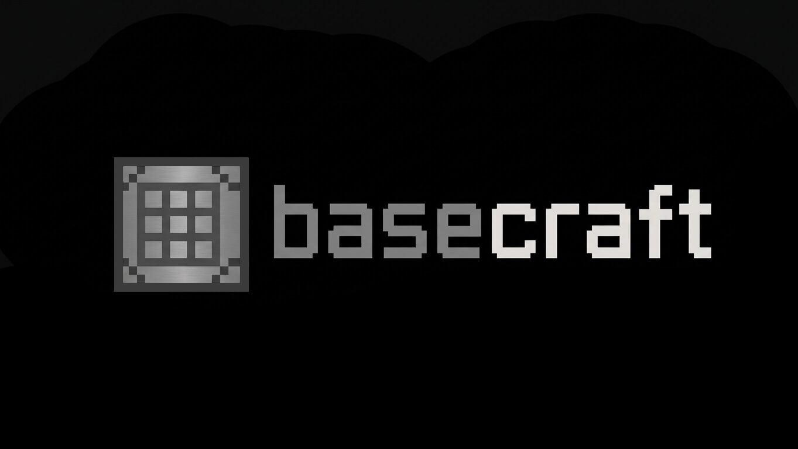

<p align="center">
  
</p>

<p align="center">
  Errores de dominio tipados para representar fallos de negocio de forma explícita.
</p>

---

`@basecraft/errors` ofrece una base común para construir errores de dominio en aplicaciones TypeScript. Todos los errores heredan de `DomainError`, incluyen un `code` tipado y establecen automáticamente su `name`.

## Instalación

```bash
npm install @basecraft/errors
```

## Errores incluidos

| Error | Código | Descripción |
| --- | --- | --- |
| `DomainError` | Genérico (`string`) | Clase base abstracta para definir errores de dominio personalizados. |
| `AuthenticationRequiredError` | `AUTHENTICATION_REQUIRED` | Indica que se requiere autenticación para continuar. |
| `AuthorizationError` | `AUTHORIZATION_ERROR` | Indica que el usuario no está autorizado para realizar la operación. |
| `InvalidRequestError` | `INVALID_REQUEST` | Indica que la solicitud recibida no es válida. |
| `UnexpectedError` | `UNEXPECTED_ERROR` | Representa un error inesperado no controlado por el dominio. |
